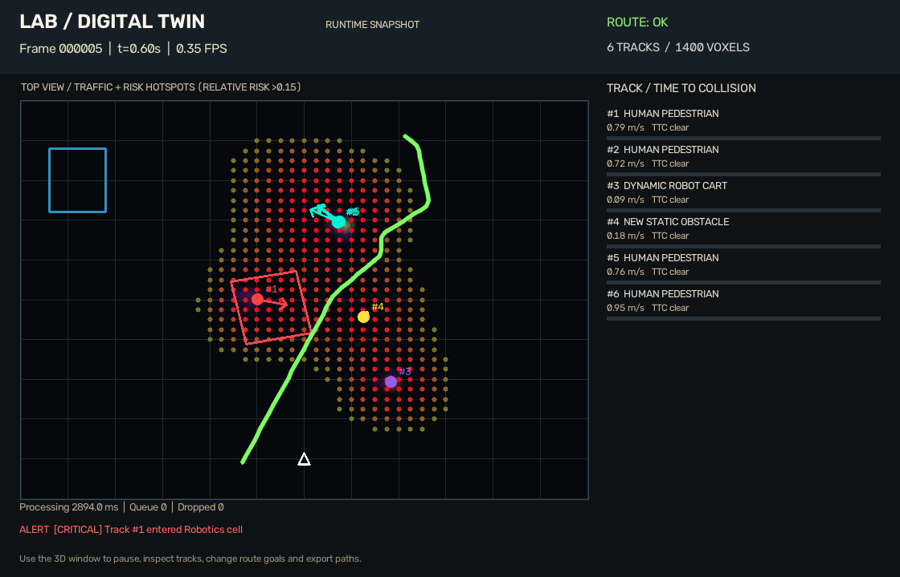

# AetherTwin — lab digital twin

A Python research platform for calibrated LiDAR/RGB-D perception, measured 3D
mapping, learned voxel semantics and scene flow, multi-object tracking, and
collision-checked trajectory simulation. The original supplied specification is
preserved in **SPEC.md**. Implementation corrections are recorded below.



*Simulated runtime snapshot from the bundled demonstration (no physical sensors).*

The bundled demonstration needs no sensors. It includes a trained synthetic
checkpoint, measured simulator commissioning scans, a reconstructed twin, and a
conservative navigation map. Physical robot commands are not emitted.

The current deployment direction is **Raspberry Pi 5 sensor capture + Windows
workstation with NVIDIA A2000 processing**, using **Unitree 4D LiDAR L2/IMU,
Orbbec Gemini 335L and ESP32**. Jetson is no longer the selected deployment.
The Pi-to-Windows raw-sensor bridge is still pending; the existing gateway relays
processed scene state and is not a raw-sensor transport. Physical capture,
calibration, Pi compatibility and A2000 performance remain unverified.

The bundled simulation and replay run today. See [current status](docs/PROJECT_STATUS.md),
[repository structure](docs/REPOSITORY_STRUCTURE.md), and the
[Pi/Windows deployment handoff](docs/RASPBERRY_PI_WINDOWS.md). Historical Jetson
profiles, plans and test evidence are retained for provenance, not active setup.

## Start

Use Python **3.12** in a virtual environment. From this project folder:

```powershell
py -3.12 -m venv .venv
.venv\Scripts\python.exe -m pip install --require-hashes -r requirements-windows.lock
.venv\Scripts\python.exe -m command_center --mode sim --open-browser
```

On Ubuntu 24.04:

```sh
python3.12 -m venv .venv
.venv/bin/python -m pip install --require-hashes -r requirements-ubuntu.lock
.venv/bin/python -m command_center --mode sim --open-browser
```

For the environment prepared with this delivery, the interpreter is
`../../work/locked_venv/Scripts/python.exe`. `Run AetherTwin.cmd` opens the browser
demonstration. `Run Lab.cmd` retains the Open3D/OpenCV viewer. Both select that
environment or a project-local `.venv`. The classic Windows viewer defaults to
the included Mesa software renderer. The browser uses its own GPU rendering.
Ubuntu's classic viewer uses the native OpenGL driver. See **Graphics verification** for
the process-local Windows compatibility adapter and its source/licences.

You may also install this project with `python -m pip install .` and run
`lab-twin`. The wheel includes configuration, checkpoints and demonstration data;
outputs are written under the current working directory. `LAB_TWIN_DATA_DIR`
can select another delivered resource folder. Package installation never needs
write access to its installed assets during a normal demonstration.

Run a bounded demonstration with no windows:

```sh
python main.py --mode sim --headless --max-frames 30 --output artifacts/demo
```

The report records achieved processing speed, latency, memory, configuration,
and route status. Simulation advances by acquisition timestamps; it does not
pretend that slow CPU processing is a 10 Hz deployment. `--real-time` adds pacing
only when processing is faster than sensor time.

Measured results, configurations and limits are in `reports/BENCHMARK.md` and
`reports/ACCEPTANCE.md`. Processing and browser rendering have separate budgets.
The 35ms pipeline target remains future work; synthetic measurements are not
Pi, A2000 or real-lab performance claims.

For architecture, first physical setup and private deployment, read
[architecture](docs/AETHERTWIN_ARCHITECTURE.md),
[physical commissioning](docs/PHYSICAL_COMMISSIONING.md),
[Pi/Windows setup](docs/RASPBERRY_PI_WINDOWS.md) and
[gateway setup](deployment/gateway/README.md). The `deployment/edge/` NVIDIA
recipe is retained as a historical alternative. Do not install the Windows/x86
locks or the complete ML stack on the Pi capture node.

## Workflows

| Mode | Behavior | Example |
|---|---|---|
| `sim` | Simulate all sensors and process observations through the full stack | `python main.py --mode sim --headless --max-frames 30` |
| `replay` | Replay bounded NPZ chunks with their calibration and matching twin | `python main.py --mode replay --input assets/sample_recording --headless` |
| `build-twin` | Register explicitly empty-room scans; reconstruct TSDF/Poisson surfaces and measured free space | `python main.py --mode build-twin --commissioning-mode stations --input assets/twin_seed7/commissioning --output artifacts/rebuilt_twin` |
| `pretrain` | Train the shared point encoder/spatial hierarchy with 60% masked patches and Chamfer loss | `python main.py --mode pretrain --epochs 2 --max-frames 12 --output assets/checkpoints/point_mae.pt` |
| `train` | Train camera features plus seven-class semantics and scene flow | `python main.py --mode train --epochs 24 --mae-checkpoint assets/checkpoints/point_mae.pt --output artifacts/trained.pt` |
| `evaluate` | Evaluate independent scene seeds and compare learned outputs with baselines | `python main.py --mode evaluate --output artifacts/evaluation.json` |
| `calibrate` | Solve measured 3D-to-2D correspondences with RANSAC/LM refinement and uncertainty reporting | `python main.py --mode calibrate --input observations.npz --output artifacts/measured_calibration.json` |
| `live` | Acquire required L2, IMU and Gemini streams through their official SDKs | `python main.py --mode live --twin /path/to/measured_twin --config /path/to/lab.yaml` |
| `hil-test` | Run ordinary observation diagnostics and separately labelled virtual targets | `python main.py --mode hil-test --max-frames 8 --output artifacts/diagnostic-new` |

Shared switches include `--config`, `--seed`, `--device cpu|cuda|auto`,
`--checkpoint`, `--record`, `--headless`, `--max-frames`, `--duration`, and
`--threads`. `--mobile` enables carried-state IMU deskew and ICP localization.
`--websocket` enables loopback telemetry at `ws://127.0.0.1:8765` by default.
Neural neighbor counts and RGB-D sample stride are explicit under `perception`
in the configuration; simulation image/beam counts and map/planning resolutions
are also recorded in every benchmark. The dense acquisition cloud separately
uses stride 3. To evaluate a new training run, pass its output with `--checkpoint`.

To record observations and their matching twin:

```sh
python main.py --mode sim --headless --max-frames 12 --record artifacts/my_recording
python main.py --mode replay --headless --input artifacts/my_recording --max-frames 12
```

Existing recordings are never overwritten. A reconstruction rebuild is staged
before publication and preserves the preceding bundle in a `.previous-*` folder.
The shipped legacy commissioning scans are independent stationary captures with
reset timestamps, hence the explicit `--commissioning-mode stations` above.
New moving scans use `auto`/`mobile` and continuous IMU history; overlapping raw
sweeps are rejected. Stationarity is never inferred from zero gyro alone.
Recording queues, chunks and disk quotas are configurable under `recording`.
Incomplete async captures retain `recording_status.json`; normal replay rejects
them and verifies chunk checksums. Explicit recovery is a separate operation.
Use `--rebuild-twin` to build a fresh simulator reconstruction under
`artifacts/twin_seed<seed>`, or add `--twin <folder>` to choose its location.

## What runs

```mermaid
flowchart LR
  A[SDKs / simulation / recording] --> B[Clock alignment and IMU deskew]
  B --> C[ICP and calibrated RGB-D fusion]
  C --> D[Measured occupancy and twin difference]
  D --> E[Learned voxel encoding and PointNet++ hierarchy]
  E --> F[Range and camera attention / temporal correlation]
  F --> G[Semantics and scene flow]
  G --> H[Kalman and Hungarian tracking]
  H --> I[Risk / geofences / traffic]
  I --> J[A* / constrained spline / MPPI]
  J --> K[3D command center / HUD / telemetry]
```



- Sensor frames own read-only arrays and keep ground truth in a separate
  training/evaluation object. Runtime perception does not receive labels,
  object identities, or the simulator's architectural mesh.
- Synthetic truth exposes clean continuous material correspondences separately:
  current/prior world positions, per-return capture times, prior times and
  validity. They come from physics/mesh hits before sensor noise; changing ray
  patterns do not turn them into nearest-neighbor guesses. Camera pairs use
  row-major image order, and the first interval has no valid previous pairs.
  `assets/ground_truth_example` contains two raw sensor frames and separate
  truth sidecars. Reproduce it with `python tools/export_ground_truth_example.py`.
- World coordinates are right-handed with Z up. Camera coordinates are X right,
  Y down, Z forward. LiDAR points retain acquisition offsets from sweep start;
  deskewed snapshots are referenced to sweep end. Distances are metres and times
  are seconds on a common monotonic epoch; raw device stamps are retained.
- Raw return endpoints and optional per-return origins are expressed in each
  acquisition's LiDAR frame. Deskew transforms both into sweep-end coordinates,
  preserving each ray's observed segment. Effective camera capture pose and S2
  cloud/origin use that same reference; measured extrinsics and calibration
  identity remain intact. Auxiliary capture times require measured IMU coverage,
  including buffered future samples when necessary; extrapolation is rejected.
  A recorded sweep-end frame is explicitly marked and cannot be deskewed twice.
- LiDAR and calibrated depth points jointly populate the learned voxel input.
  Optional S2 observations also update occupancy using their calibrated origin.
- Voxel identity is the integer coordinate tuple; the 64-bit prime hash is only
  a bucket key. Exact batched DDA clears only measured ray segments, retains
  intermediate echoes, and leaves space beyond final returns unknown.
- Commissioned evidence persists separately from decaying dynamic observations.
  Every source voxel overlapping a planning cell counts. Unknown space remains
  blocked, and every published trajectory receives swept footprint checks.
- A simulated point robot follows accepted time-parameterized trajectories.
  New evidence invalidates unsafe routes immediately, between scheduled searches.
  Invalid or unavailable routes hold the simulated robot at zero velocity.
- GUI snapshots use a bounded queue. Processing, rendering and optional network
  consumers do not share mutable frame geometry. Slow telemetry consumers lose
  intermediate snapshots rather than blocking perception.

## Learning and measured evidence

The packaged network uses learned point-to-voxel encoding, 64/128/256 spatial
features, multiscale PointNet++ abstraction, camera/range cross-attention, and
local cross-frame correlation. Neighbor searches are spatial, not full-cloud
pairwise distance matrices. Training includes weighted focal/Lovasz semantics,
flow Huber loss, rigidity consistency, and a camera semantic loss.

The synthetic training seeds are 1–6, validation seeds 101–102, and held-out
evaluation seeds 201–202. Seeds vary geometry, material colors, and motion.
The bundled checkpoint was selected on validation performance after a 24-epoch
run initialized from the supplied masked-pretraining checkpoint.

Current held-out results over 24 frames are in `artifacts/evaluation.json`:

| Metric | Trained model | Baseline |
|---|---:|---:|
| Seven-class mean IoU | 0.9851 | 0.0971 majority class |
| Dynamic scene-flow endpoint error | 0.0219 m | 0.0376 m zero motion |
| All-voxel scene-flow endpoint error | 0.0119 m | 0.0010 m zero motion |

The all-voxel baseline benefits from the many static points and is better than
the learned flow there. These small, procedurally generated scenes do not prove
real-lab accuracy. Per-class counts/confusions, dataset seeds, and checkpoint
metadata remain in the report; thin-wire evidence is especially sparse.

To train on annotated recordings, supply a version-1 dataset manifest. Paths
are relative to that file; training, validation and test must use distinct scene
identities and recording directories. A complete small **synthetic format
example** is included at `assets/supervised_example/dataset.json`:

```sh
python main.py --mode train --input assets/supervised_example/dataset.json --checkpoint assets/checkpoints/synthetic.pt --epochs 5 --output artifacts/fine_tuned.pt
python main.py --mode evaluate --input assets/supervised_example/dataset.json --checkpoint artifacts/fine_tuned.pt --output artifacts/annotated_evaluation.json
```

Each scene entry names `scene_id`, `recording`, `labels`, `twin`, and `mobile`.
Each `labels/000000.npz` sidecar matches a recorded frame ID and contains
`semantic` (N), `flow` (N×3), `instance_ids` (N), and `flow_valid` (N). RGB-D
recordings also require `camera_semantic` (H×W), `camera_flow` (H×W×3),
`camera_instance_ids` (H×W), and `camera_flow_valid` (H×W). Class indices are 0–6.
Flow is previous-to-current displacement in metres in the recording's world
frame, before floor alignment. Frame IDs and optional timestamps are validated.
Ground-truth pose sidecars never initialize runtime localization. See
`perception_ml/recorded_dataset.py` for the full contract and validation rules.

Fine-tuning loads every trained head and uses a smaller learning rate. It writes
a new checkpoint by default; the bundled checkpoint is preserved. The included
annotated example verifies ingestion and fine-tuning only: its nine frames are
synthetic and provide no evidence of real-lab performance.

The checkpoint has seven classes: ground, architecture, pedestrian, moving
robot/cart, new static hazard, thin wire/cable, and permeable foliage. Newly
placed hazards receive map-residual and persistence context, rather than being
inferred from material color alone.

## Command center

`python -m command_center` serves the packaged browser at127.0.0.1:8080. It offers
camera presets, layer visibility, observed/predicted track inspection, risk,
geofences, traffic, RGB-D, routes, replay controls and CSV export. The architecture
panel displays actual module timing and array dimensions. The commissioning
panel runs isolated bounded jobs for configured sources and produces candidates,
without activating a new map or calibration. Live diagnostics require exclusive
sensor ownership through the documented console workflow.

The same address serves `/explainer.html` ("What is this?" in the studio header): a
step-by-step explanation of the pipeline for non-specialists and engineers, with
small interactive labs (motion deskew, log-odds mapping, shape descriptors, risk and
time to collision), the measured results with their sources, and what is not yet
proven. Each stage links back to the studio with its layers and camera view
(`/?layers=path,risk&view=top`). `npm run build:explainer` (in `web/`) writes a
standalone, shareable copy to `web/explainer-dist/` that shows recorded results only.

Render quality **Photoreal** adds image-based lighting, soft shadows and ambient
occlusion (presentation only). `--appearance DIR` adds a visual-only photo capture
of the lab (a textured `.glb` from photogrammetry, with its alignment recorded) as
the **Photo capture** layer; see `docs/LAB_APPEARANCE.md` for capture, packaging
(`tools/package_lab_appearance.py`) and alignment rules.

Use `--record PATH` to retain raw observations in separate source segments,
`--duration`/`--max-frames` for bounded processing, and `--input` for replay.
The default laptop profile pages occupancy within an explicit64MiB cache limit.
Private listeners require TLS and separate operator/viewer credentials; the
gateway installation is described in `deployment/gateway/README.md`.

The classic Open3D/OpenCV command center is still available with
`python main.py --mode sim`:

The viewer provides orbit/zoom, layer visibility, pause/resume, track inspection,
start/goal coordinates, route planning, and CSV export. The HUD shows processing
rate, tracks, TTC, risk, traffic density, route state, and recent geofence events.
The export includes trajectory time and XYZ coordinates in SI units.

The default cutaway removes ceiling and camera-facing perimeter triangles from
the display copy so interior tracks and routes remain visible. Turn off
**Cutaway room view** to restore the measured mesh. **Inferred closed mesh**
shows the separately reconstructed watertight surface as an optional wireframe;
its inferred closure has no authority to declare free navigation space. Risk
colors show a relative directional score, rather than a calibrated probability
of collision. Hidden low-risk floor dots do not imply observed free space.

`artifacts/runtime_scene_preview.png` renders the saved real model snapshot,
and its companion JSON records its source and visible layers. It is a generated
scene export, separate from interactive acceptance evidence.

The default navigation layer is at Z=0.625 m for a conservative 0.25 m occupancy
grid and 0.20 m footprint radius. Lowering it to 0.375 m intersects the observed
floor voxel band and is correctly rejected. This is a geometric planning
reference height, not a hardware vehicle specification. A goal may become
unavailable as new evidence or predicted tracks block it; the robot then waits.

## Physical sensors and calibration

The Unitree L2 adapter is a thin native binding to the official SDK2. Its point
format exposes ring, not echo index/count; live L2 frames explicitly mark echo
metadata unavailable. Multi-return algorithms are exercised by synthetic and
compatible recorded beams. Ring values are never treated as echoes.

The Gemini adapter uses Orbbec SDK v2, enumerates available color/depth profiles,
aligns RGB-D, and reports software synchronization error. Default depth is
1280×800 at 30 fps. Camera intrinsics/extrinsics must correspond to the actual
aligned profile. Simulation calibration is visibly marked unmeasured and is
rejected by live fusion.
Depth and color are negotiated independently. Depth defaults to 1280×800 at
30 fps; color defaults to the measured calibration's `image_size:[width,height]`.
The adapter selects an SDK-approved D2C pair and validates actual aligned image
dimensions, intrinsics and distortion against that measured profile. It supports
hardware alignment and documented SDK software alignment, with the selected
mode and source/output profiles retained in diagnostics. It never rescales K.
Override `live.camera_color_width`, `camera_color_height`, `camera_color_fps`,
or `camera_align_mode` explicitly when commissioning a profile. Physical capture
and exposure synchronization remain unverified without the devices.

The optional camera extra pins the reviewed `pyorbbecsdk2==2.1.2` package:
`python -m pip install ".[camera]"` after installing the platform lock.

For offline calibration, `observations.npz` contains `lidar_points` (N×3),
`image_points` (N×2), `K` (3×3), and optional five-element `distortion`, with at
least six well-distributed measured correspondences. The output contains
reprojection error, inliers, transform, and covariance. Collect multiple board
orientations/ranges and inspect residuals before live use.
Include `image_size` ([width,height]) for a live-ready profile and a boolean
`measured` provenance flag in the input NPZ. Missing provenance assumes the
user supplied measured observations. The bundled synthetic example explicitly
sets `measured=false`; its solver output stays synthetic. Calibration identities
include a digest of the fitted parameters and profile instead of reusing a
generic identity for different installations.

Legacy S2 recordings remain readable. S2 acquisition/simulation is disabled in
the current hardware profiles, and the native build defaults to
`WITH_SLAMTEC=OFF`. Archived adapter details remain in `native/README.md`;
they are not part of this rig's commissioning workflow.

`native/README.md` describes SDK revisions and compilation. Both vendor bindings
compiled and imported on Ubuntu 24.04. Physical acquisition, real calibration,
field reliability, and real-lab neural quality remain unverified without devices
and measured lab data. Live mode never switches silently to the simulator.

## Verification and specification corrections

Run `python -m pytest -q`. Set `RUN_OBSERVED_INTEGRATION=1` to include a dense,
observation-only commissioning/navigation regression. Tests cover analytic
SE(3), carried pointwise deskew, ray boundaries, deliberate hash collisions,
calibration, replay, learned gradients, OBB intersections/GIoU, covariance,
tracking, conservative 3D planning, new-obstacle invalidation and safe waiting.

Corrections to the pasted references include:

1. `voxel_coords` and `position` replace inconsistent reference field names.
2. Deskew evaluates each point's timestamp; it does not use 32 time bins or reset
   velocity at every sweep. Rotations near zero and pi are handled stably.
3. Ten descriptor channels are explicitly the eight specified invariants plus
   eigenvalue sum and neighborhood height standard deviation.
4. Hash collisions cannot merge unrelated voxels; free-ray updates and
   elapsed-time decay are implemented rather than updating hits only.
5. 3D OBB overlap uses separating axes, including crossings with no contained
   corners. Oriented GIoU uses convex intersection/enclosing volumes.
6. Navigation includes volumetric A*, constrained splines, MPPI and final exact
   swept checks. It does not rely on the reference floor-only risk threshold.
7. Arbitrary untrained weights are not presented as semantic inference. Bundled
   weights were trained; model/data provenance remains explicit.
8. Reconstructed visual surfaces do not turn unobserved space into navigable
   free space. Mesh topology/coverage is reported, not assumed watertight.

## Graphics verification

Open3D 0.20 failed native Vulkan teardown on this laptop. The pinned 0.19 with
the current AMD driver produced a blank generated-geometry render. The delivered
Mesa 26.2.4 path now renders and exits normally. A small source-built WGL adapter
corrects the old Filament context/pixel-format requests and forwards the other
exports to Mesa. DLL hashes are verified before loading. This affects only the
application process and changes no operating-system settings. Source, build
instructions and policy tests are in `native/wgl_compat`; redistribution licences
and provenance are in `assets/rendering/mesa`.

`--render-backend native|mesa|auto` selects the backend. The generated sphere
component report `artifacts/render_verified_backend.json` records 4,118 foreground
pixels, 3,323 distinct colors, and normal teardown. It renders our own geometry;
it is separate from desktop inspection.

Desktop computer-use checks verified pause/resume, layers, changed trajectory
goals, CSV export, visible alerts and shutdown. Browser acceptance and measured
rendering evidence are indexed in `reports/ACCEPTANCE.md`. Automated checks and
interactive checks are recorded separately.

## Reproducing verification

`reports/ACCEPTANCE.md` and `reports/REQUIREMENTS_MATRIX.md` index implementation
and acceptance evidence. Windows/Ubuntu replay of the identical shipped recording
matches at rtol=1e-5, atol=2e-5; measured occupancy matches bit for bit across all
70,159 cells. `reports/cross_platform_replay.json` records the compared fields.
The pinned locks include wheel hashes and the CPU PyTorch index. Regenerate
them with `python -m pip install uv`, then `python tools/lock_dependencies.py`;
the delivered `requirements-constraints.txt` preserves the reviewed versions.
Optional live SDK builds and reviewed revisions are documented separately in
`native/README.md`.

For a30-minute browser/pipeline run with bounded recording and external sampling:

```sh
python tools/browser_stability_run.py --duration 1800 --output artifacts/endurance-new --record artifacts/endurance-raw
```

On Windows a visual run requests both system and display availability for the
process lifetime, without changing a power setting. Battery/Modern Standby policy,
closing the lid or manual sleep may still interrupt it; power clocks, UI gaps and
system sleep/resume events distinguish such interruptions from processing latency.
See the [Windows execution-state documentation](https://learn.microsoft.com/en-us/windows/win32/api/winbase/nf-winbase-setthreadexecutionstate).
Benchmark
reports include actual resolution/sampling settings, latency, memory and queue
statistics. Short runs save raw latency/memory samples for plotting.
