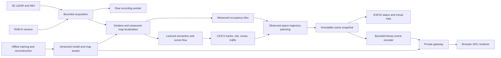

# AetherTwin software architecture

The approved scope is retained in `SPEC.md` and
`AETHERTWIN_IMPLEMENTATION_PLAN.md`. The supported rig profile uses L2 3D LiDAR
with IMU, Gemini335L RGB-D and ESP32. S2 data remains readable in legacy
recordings; the current configuration and commissioning workflow do not use it.

The selected deployment separates Raspberry Pi capture from Windows A2000
localization, occupancy, inference, tracking, risk, planning and recording.
The raw-sensor network bridge between these hosts is pending implementation and
physical verification. The diagram describes the existing logical pipeline;
it does not imply that distributed capture is already integrated. The
gateway validates and relays one edge stream to bounded viewers; its separate
installation needs no neural models or sensor SDKs. The browser retains static
GLB geometry on the GPU and receives scene updates. Rendering does not wait for
the next perception frame. Predictions and stale observations remain labelled.

Windows supports the complete simulation and offline workflow. Existing
Windows measurements use CPU PyTorch; an A2000 CUDA installation needs its own
verification. Ubuntu 24.04 x86 verification does not establish Pi ARM64
compatibility. See [the current deployment handoff](RASPBERRY_PI_WINDOWS.md).
The NVIDIA recipe in `../deployment/edge/README.md` is historical. No board
upgrade, firmware flash or external deployment is performed by setup.

## Memory, storage and work limits

Acquisition caps retained frames, bytes and age, and separately retains bounded
IMU history. Recording has independent chunk, queue and disk quotas; recording
overruns remain visible and incomplete captures require explicit recovery.
Chunks have checksums. Processing never receives training labels.

Occupancy uses collision-safe coordinate tuples and exact traversal. Spatial
tiles have a fixed resident count/byte budget and disk quota. Inactive tiles are
paged; planning loads the requested observed region within its explicit cell
budget. An oversized region returns a resource-limit result. Unknown space
blocks navigation. Meshing and detail levels never replace measured occupancy.

The scene encoder has one pending snapshot; client queues coalesce obsolete
updates into a recoverable keyframe. Sequence gaps require resynchronization.
The gateway bounds messages, HTTP concurrency, assets, clients and retained map
generations. Slow consumers do not block capture. Offline commissioning jobs
run in isolated processes with bounded queue, time and aggregate output quota.

Every report records raw simulation dimensions, processing stride, feature
resolution, voxel sizes, neural sampling and neighborhood budgets. The sensor
profile and processing profile are distinct. Retained algorithms run at their
appropriate processing/offline cadence; no benchmark represents CPU simulation
as real sensor throughput. The 35ms pipeline limit remains a future target.

## Private access and growth

Both listeners default to loopback. Network listeners require scoped credentials
and TLS; remote upstream certificate verification is mandatory. Credentials stay
in the service environment and HttpOnly sessions, never WebSocket URLs.
Viewer accounts cannot change zones or request routes. Operator commands are
acknowledged, revision checked and applied at a processing boundary; acceptance
and successful application are separate events.

Use one edge service and one gateway for this lab. Additional labs can use the
same packages with separate lab/rig identities, map revisions, storage quotas and
credentials. Start with independent instances and measured capacity. A future
shared organization service should add centralized identity, per-lab access
control and durable asset/history storage before adding many users. Cluster
infrastructure and continuous video encoding are unnecessary for this pilot.

See `TELEMETRY_V2.md`, `BOUNDED_COMMISSIONING.md`,
`CALIBRATION_OBSERVABILITY.md`, `../deployment/gateway/README.md` and the
measured release evidence under `../reports/`.
